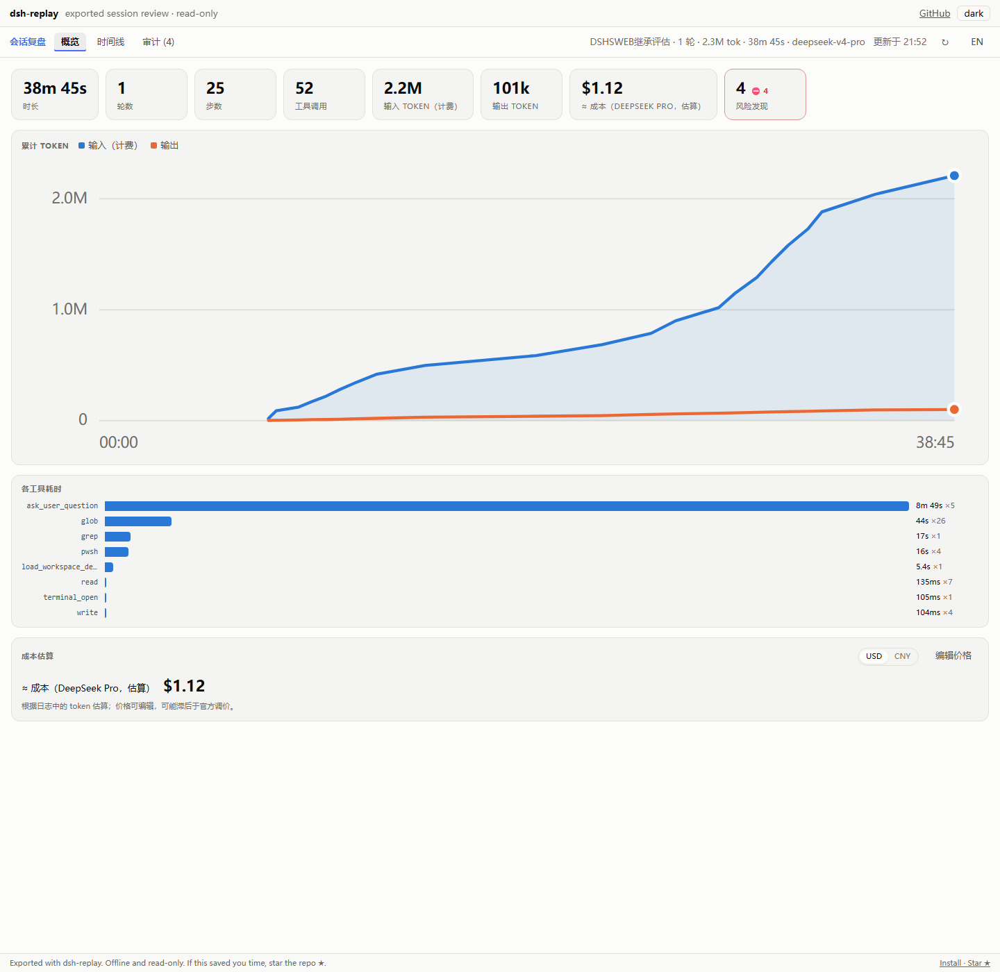

# launch-dsh-replay



> 上图：导出的离线单文件 HTML 在浏览器中的实拍（桌面端 v4 会话：1 轮 / 25 步 / 52 次工具调用 /
> 4 条风险发现 / token 曲线 / 成本估算）。一张图抵一段说明书。

## 这是什么（人话版）

**DSH 会话回放器**：把 DeepSeek Harness 的会话日志（`session.v4.jsonl.zstd` / 旧版 v3）
读出来，变成一个可以点、可以翻、可以分享的**时间线页面**——每一轮对话、每一步推理、
每次工具调用和它的结果、审批弹窗、交付物、token 消耗与成本估算、安全审计发现都在里面。

它解决两个具体问题：

1. **DSH 起不来时也能看会话**：闪退、升级翻车、换机器、离线，都不影响——本项目不依赖 DSH 运行。
2. **把一次会话发给别人看**：导出一个自包含 HTML 文件，对方双击就能看，不用装任何东西。

特性一句话：**只读、零依赖、离线**；v3 + v4 双格式；CLI + 本地引导页 + Windows 一键启动。

## 环境依赖

| 项 | 要求 | 说明 |
|---|---|---|
| Node.js | **≥ 22.19** | 只用它内置的 zstd；无任何 npm 依赖。校验：`node -p "typeof require('node:zlib').zstdDecompressSync"` 输出 `function` |
| 操作系统 | Windows 10/11（推荐） | 一键安装器、桌面快捷方式、`.cmd` 启动器；macOS/Linux 用同样的 `node` 命令，功能等价 |
| DSH 会话日志 | 有即可 | 默认 `~/.dsh/sessions`，也认 `DSH_HOME/sessions`；`DSH_REPLAY_ROOT` 可显式指定 |
| 网络 | 不需要 | 解析引擎与 React viewer 已内置 |
| 磁盘/权限 | ~1 MB；会话目录只读 | 渲染输出写系统临时目录 |

## 目录结构

```
launch-dsh-replay/
├─ install.cmd               Windows 一键安装（双击）
├─ install.ps1               安装器实现（安装/卸载/校验/快捷方式/转发入口）
├─ dsh-replay-web.mjs        本地引导页 + 渲染服务（127.0.0.1:7781）
├─ render.mjs                命令行：列表 / 渲染 / 统计
├─ lib/decode.mjs            拼接式 zstd 帧解码（兼容写入中的 torn tail）
├─ lib/sessions.mjs          会话发现 / 根目录解析 / 元数据缓存 / 单文件 HTML 导出
├─ tests/smoke.mjs           自检（8 项，零依赖、无需 DSH）
├─ launch-dsh-replay.cmd     Windows 双击启动（纯 ASCII）
├─ launch-dsh-replay.ps1     Windows 交互菜单
├─ docs/replay-overview.png  回放界面实拍
├─ CHANGELOG.md              版本记录
├─ LICENSE                   本项目 MIT（含第三方声明）
├─ .gitignore / .gitattributes
└─ vendor/dsh-replay/        解析/时间线/审计引擎 + 离线 viewer（MIT，未改动）
   ├─ core.js  viewer.js
   ├─ LICENSE  NOTICE.md
```

> 发布包为 `launch-dsh-replay-1.1.1.zip`，解压得到 `launch-dsh-replay-1.1.1/`；
> 同目录附 `SHA256SUMS.txt`，校验：`Get-FileHash launch-dsh-replay-1.1.1.zip -Algorithm SHA256`。

## 安装

### 方式 A：解压即用（任何平台，最快）

```bash
node tests/smoke.mjs                  # 8/8 通过 = 环境 OK
node render.mjs --list                # 能列出会话 = 路径找对了
node render.mjs --latest --out r.html # 渲染最近会话 → 离线单文件 HTML
node dsh-replay-web.mjs --no-open     # 引导页 http://127.0.0.1:7781/
```

不需要 `npm install`，不需要编译，不写注册表。

### 方式 B：Windows 一键安装

双击 **`install.cmd`**（或 `powershell -NoProfile -ExecutionPolicy Bypass -File .\install.ps1`）：

1. 校验 Node ≥ 22.19 且内置 zstd 可用；
2. 复制到 `%LOCALAPPDATA%\launch-dsh-replay`（可用 `-Target` 改）；
3. 跑自检，必须 8/8 通过；
4. 创建桌面快捷方式「DSH 会话回放」和 `~/.dsh\launch-dsh-replay.cmd` 转发入口（`-Minimal` 可跳过）。

```powershell
# 常用参数
.\install.ps1 -Target D:\tools\launch-dsh-replay   # 自定义安装目录
.\install.ps1 -Minimal                             # 只装文件，不动桌面/~/.dsh
.\install.ps1 -NoTest                              # 跳过自检（不推荐）
.\install.ps1 -Uninstall -Force                    # 完全卸载
```

| 参数 | 默认 | 含义 |
|---|---|---|
| `-Target` | `%LOCALAPPDATA%\launch-dsh-replay` | 安装目录 |
| `-DesktopDir` | 系统桌面 | 快捷方式位置（OneDrive 重定向时自动跟随） |
| `-DshLauncherDir` | `~/.dsh` | 转发入口位置；目录不存在则跳过 |
| `-Minimal` | 关 | 不建快捷方式/转发入口 |
| `-NoTest` | 关 | 跳过安装后自检 |
| `-Icon` | `~/.dsh/dsh.ico`（若有） | 快捷方式图标 |
| `-Uninstall` / `-Force` | — | 卸载；`-Force` 才删除安装目录 |

> 直接双击 `.cmd` 若出现 Windows「打开文件 - 安全警告 · 无法验证发布者」，那是系统对未签名
> 脚本的通用提示，不是项目出错，点「运行」即可。快捷方式走 `cmd.exe /k node …`，不会再弹。

### 方式 C：只手动接线（不装安装器）

- 启动引导页：`node <解压目录>\dsh-replay-web.mjs`
- 自建快捷方式：目标 `cmd.exe`，参数 `/k "<node.exe>" "<解压目录>\dsh-replay-web.mjs"`，起始位置填解压目录。

## 快速开始

**Windows**：桌面「DSH 会话回放」→ 浏览器打开引导页 → 点任意会话。

**任意平台**：

```bash
node render.mjs --list [--json]                     # 最近会话列表
node render.mjs --latest [--out r.html]             # 渲染最近一个会话
node render.mjs --id <session-id> [--out r.html]    # 按 id 渲染
node render.mjs --file <session.v4.jsonl.zstd> [--out r.html]
node render.mjs --file <path> --stats               # 只打印统计 JSON
node dsh-replay-web.mjs [--port 7781] [--limit 40] [--no-open]
```

环境变量：`DSH_REPLAY_PORT` / `DSH_REPLAY_ROOT` / `DSH_REPLAY_OUT` / `DSH_HOME`。

- 会话根目录解析顺序：`DSH_REPLAY_ROOT` → `DSH_HOME/sessions` → `~/.dsh/sessions`。
- 端口被别的程序占用时自动顺延（7782→7790）；本项目旧实例已在跑时，再次启动只开浏览器并保持窗口存活（不闪退）。
- 引导页路由：`/`（列表）、`/replay?id=`（渲染）、`/stats?id=`（JSON 统计）、`/health`（健康检查）。

**隐私警告（重要）**：导出的 HTML 内嵌**完整会话内容**（命令、文件内容，可能包含 token/密钥/内网
路径）。分享到 issue、群聊或公开仓库前请先人工脱敏。引导页只绑定 `127.0.0.1`——不要改成
`0.0.0.0` 对外暴露。

## 为什么能显示桌面端会话

| 项 | WEB 旧版 | 本移植 |
|---|---|---|
| 会话文件 | 只认 `session.v3.jsonl.zstd` | 先 `v4` 后 `v3`，忽略 `.bak/.orig` |
| 渲染引擎 | `pnpm dlx dsh-replay@0.2.0`（v3 语义，当前日志文件名都认不出） | 内置 `@mingozhou/dsh-replay@0.4.2` core（v4 原生解析：tool 角色结果、surfaceOp、compaction、token/成本） |
| 标题 | 无（显示 session id） | 读 `session/title` 事件显示人类可读标题 |
| 工具结果 | v4 会话下结果错位 | 按 `message.toolCallId` 精确配对，带耗时/错误态 |
| 审批 | 无 | 时间线内显示 approval 提问与决定 |
| 交付物 | 无 | 显示 `deliverables/presented` |
| 统计 | 只有 turns/steps/toolCalls | 追加 token、模型、审计发现（危险命令/网络/审批等） |
| 依赖 | 需要 pnpm + 首次联网 dlx | 零依赖，Node ≥ 22.19 内置 zstd，完全离线 |
| HTML 导出 | 单文件（v3 渲染） | 单文件自包含（React 内联，可分享/离线打开） |

## 格式版本矩阵与升级注意

| 磁盘上的会话文件 | 来源 | 支持 |
|---|---|---|
| `session.v4.jsonl.zstd` | DSH 桌面端 / DSH ≥ 0.2.1 | ✅ |
| `session.v3.jsonl.zstd` | 旧版 WEB DSH（0.15 线） | ✅ |
| `session.v2.jsonl.zstd` / 无版本后缀 `session.jsonl` | 更早的 DSH | ❌ 未支持（列表会跳过） |
| `session.v5.*`（未来） | 未来 DSH | ❌ 未知格式；升级 DSH 后先跑自检 + 真实会话渲染验证 |

- 本工具的 Node 门槛是 **≥22.19**（只为内置 zstd），与 DSH 本体版本要求无关
  （官方 0.2.2 起要求 Node ≥24.9，那是 DSH 自己的事）。
- 升级内置引擎：按 `vendor/dsh-replay/NOTICE.md` 从上游复制 `core.js`/`viewer.js`，
  然后跑 `node tests/smoke.mjs` + 至少一次真实 v4/v3 会话渲染回归。

## 数据来源与许可

- 渲染/解析引擎内置自 **[@mingozhou/dsh-replay](https://github.com/MingoZhou/dsh-replay) v0.4.2**（MIT），
  只把 `lib/core.js` + `lib/viewer.js` 复制进 `vendor/`，**未改动**（SHA-256 与上游一致，见
  `vendor/dsh-replay/NOTICE.md`），许可见 `vendor/dsh-replay/LICENSE`。
- 会话日志格式参考官方 `@deepseek-ai/dsh-session-format-v3-to-v4` 的迁移规范
  （工具结果从 `user` 角色的 `tool-result` block 改为 `tool` 角色一等消息）。
- 本项目自身代码 MIT，见根目录 `LICENSE`（含第三方声明）。

## 已知限制

- 超大会话（压缩后 > 10 MB）导出的单文件 HTML 会很大（几十 MB），浏览器打开慢；引导页按需渲染并缓存。
- 只读展示：不支持在回放里继续对话/修改日志；看不到**内存中**的进行中会话（读的是落盘日志，通常只差最后一次 flush）。
- 启动器仅 Windows；macOS/Linux 用 `node` 命令（功能等价）。
- 默认列出最近 40 个会话（`--limit` 可调）。

## 自测

```bash
node tests/smoke.mjs    # 8 项：zstd 帧解码 / v4 解析 / 工具结果配对 / HTML 导出 / 根目录解析
```

安装器会自动跑这条命令；8/8 通过才算装好。

## 卸载

双击 `install.cmd -Uninstall -Force`（或 `powershell -File install.ps1 -Uninstall -Force`）：
删除快捷方式、`~/.dsh` 转发入口和安装目录。会话日志与任何原始文件均未被修改。
